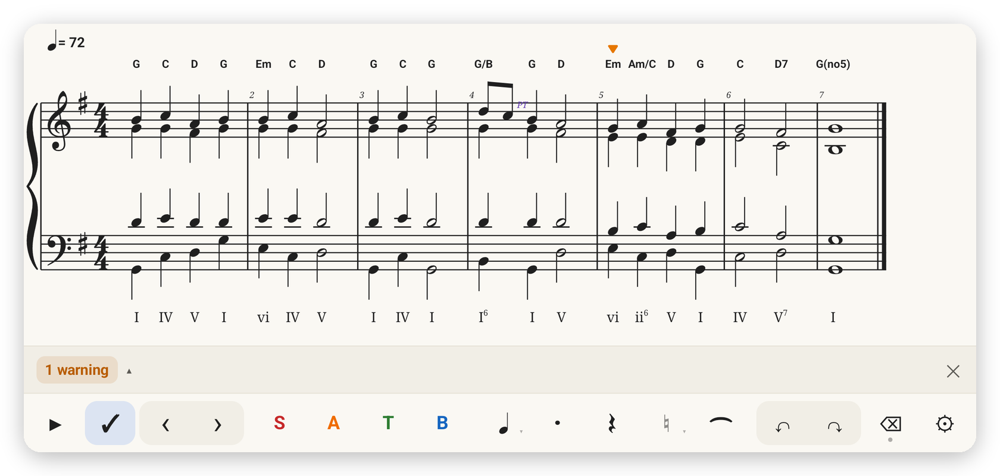
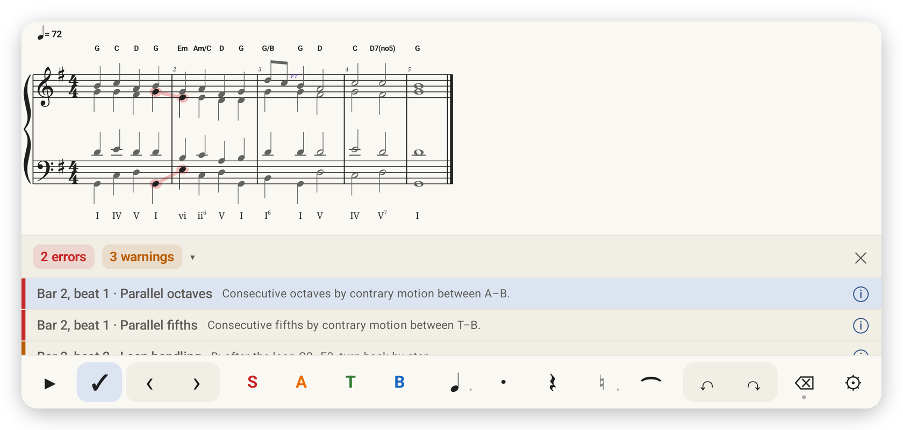
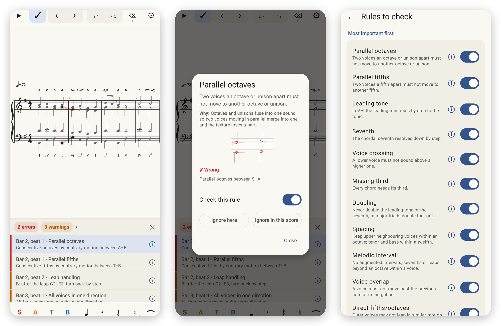

<p align="center"></p>

# SATB

An Android app for writing four-part (SATB) harmony and checking it against common-practice voice-leading rules.

<picture>
  <source media="(prefers-color-scheme: dark)" srcset="docs/images/hero-dark.png">
  
</picture>

## Features

**Writing**
- Write four voices (S, A, T, B) by tapping notes onto the staff. Touching the staff shows and plays the note before you let go.
- Enter chord by chord: alto, tenor and bass take the rhythm of the voice already written, so only the first voice needs a length.
- Hold a voice button to lock it.
- Edit pitch, length, dots, rests, accidentals and ties, with undo/redo.
- Tuplets: triplets with one tap, or any n in the time of m (5:4, 7:8 …) by holding "3".
- Choose key, time signature, tempo, clefs and staff layout.

**MIDI keyboard**
- Plug in a USB keyboard or pair a Bluetooth one (Settings → MIDI keyboard). The last keyboard reconnects by itself.
- Play a note to write it. Play a chord and let go: the highest note goes to the soprano, the lowest to the bass.
- With a voice locked, each key is written as you press it, so you can play a line legato.
- Select a note and play a key to change its pitch.

**Analysis**
- Harmony check (✓) tests 25 voice-leading rules: parallel fifths and octaves, leading tone and seventh resolution, doubling, spacing, voice crossing and more. Each rule can be turned off.
- Chord symbols and Roman numerals for every chord, including inversions and seventh chords.
- Non-chord tones are named: passing and neighbour notes, suspensions, appoggiaturas, anticipations, pedals and the cambiata.

**Sound and files**
- Playback (▶) with any SoundFont (`.sf2`) you pick.
- Export to MusicXML (MuseScore, Sibelius, Dorico and others).
- Light and dark theme.



Tap a mistake to see the notes involved. The ⓘ button explains the rule with an example.



## Install

Download the APK from the [Releases](../../releases) page, or build it yourself (see below). Requires Android 8.0 (API 26) or newer.

For playback, pick a SoundFont (`.sf2`) file in Settings. None is bundled.

## Build

Requirements: JDK 17+, Android SDK 37, NDK `27.0.12077973`, CMake `3.22.1`. Android Studio is optional; the command line is enough.

```sh
./gradlew assembleDebug            # APK in app/build/outputs/apk/debug/
./gradlew testDebugUnitTest        # unit tests
```

## License

Copyright © 2026 Nefelion

SATB is free software: you can redistribute it and/or modify it under the terms of the
[GNU General Public License v3.0](LICENSE) as published by the Free Software Foundation.
It comes with no warranty.

## Credits

Music font: [Bravura](https://github.com/steinbergmedia/bravura) by Steinberg, under the SIL Open Font License (`app/src/main/assets/Bravura-OFL.txt`).

SoundFont synthesis: [TinySoundFont](https://github.com/schellingb/TinySoundFont) by Bernhard Schelling, under the MIT License (`app/src/main/cpp/tsf.h`).
