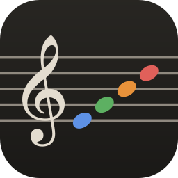
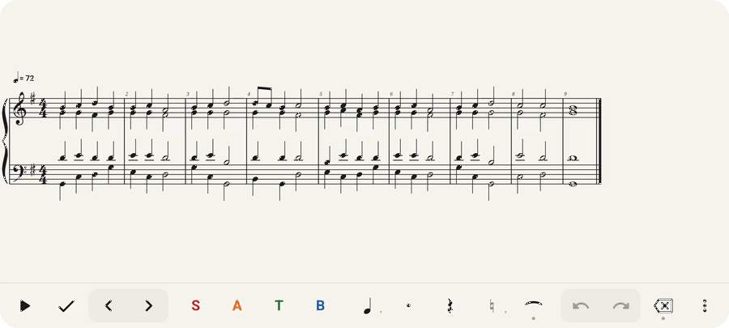
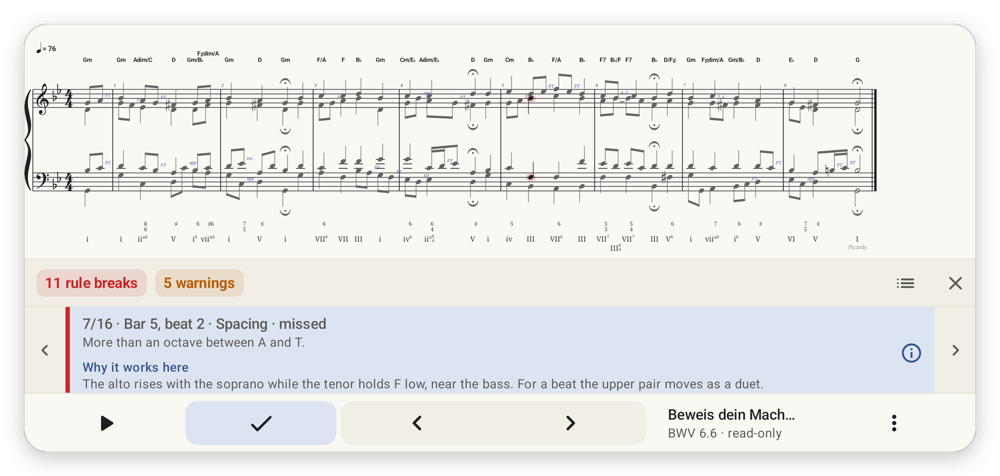
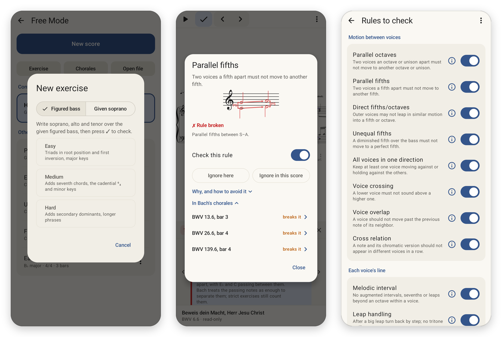

<div align="center">



# SATB

Write four-part harmony on Android and check it against the rules of voice leading.

[](../../releases/latest)

[](LICENSE)


</div>

<picture>
  <source media="(prefers-color-scheme: dark)" srcset="docs/images/demo-dark.gif">
  
</picture>

## Check

One tap checks the score against 28 rules of common-practice harmony. Find the rule breaks yourself, or have them shown. The ⓘ button explains each rule: an example, why it exists, how to avoid breaking it, and where Bach keeps or breaks it.

<details>
<summary><b>The 28 rules</b></summary>
<br>

**Motion between voices**<br>
Parallel octaves · Parallel fifths · Direct fifths/octaves · Unequal fifths · All voices in one direction · Voice crossing · Voice overlap · Cross relation

**Each voice's line**<br>
Melodic interval · Leap handling · Range · Leading tone · Seventh · Tendency tones · Non-chord tones

**Chords**<br>
Recognizable chord · Missing third · Missing voice · Doubling · Spacing · Low intervals · Six-four chords · Named chords · Figured bass

**Progression and form**<br>
Chord progression · Final cadence · Harmonic rhythm · Structure

Each rule can be switched off, or ignored for one spot or one score.

</details>

## Study

84 Bach chorales to play and check. Every rule break in them comes with a note on why Bach wrote it that way.

<picture>
  <source media="(prefers-color-scheme: dark)" srcset="docs/images/chorale-dark.png">
  
</picture>

## Practice

Figured bass and given soprano exercises at three levels, with hints and full solutions.

<picture>
  <source media="(prefers-color-scheme: dark)" srcset="docs/images/phones-dark.png">
  
</picture>

## Also

- Write by tapping notes onto the staff, or play them on a USB or Bluetooth MIDI keyboard.
- Chord symbols, Roman numerals and named non-chord tones.
- Built-in piano, or any SoundFont (`.sf2`).
- Opens MusicXML; saves MusicXML and MIDI.
- Light and dark mode. No internet permission.

## Install

Download the APK from [Releases](../../releases/latest). Requires Android 8.0 or newer.

The built-in piano plays right away. A SoundFont sounds better: pick one in Settings → Playback (none is bundled).

## Build

JDK 17+, Android SDK 37, NDK `27.0.12077973`, CMake `3.22.1`. Android Studio is optional.

```sh
./gradlew assembleDebug        # APK in app/build/outputs/apk/debug/
./gradlew testDebugUnitTest    # unit tests
```

## Credits

- Music font: [Bravura](https://github.com/steinbergmedia/bravura) by Steinberg, SIL Open Font License (`app/src/main/assets/Bravura-OFL.txt`).
- Chorales: the [Bach Chorales Figured Bass dataset](https://github.com/juyaolongpaul/Bach_chorale_FB) by Yaolong Ju et al., based on the Neue Bach-Ausgabe, [CC BY 4.0](https://creativecommons.org/licenses/by/4.0/). Converted to the app's format: continuo part left out, old modal key signatures written as modern ones (`app/src/main/assets/study/`).
- SoundFont synthesis: [TinySoundFont](https://github.com/schellingb/TinySoundFont) by Bernhard Schelling, MIT License (`app/src/main/cpp/tsf.h`).

## License

Copyright © 2026 Nefelion. Free software under the [GNU General Public License v3.0](LICENSE); it comes with no warranty.
